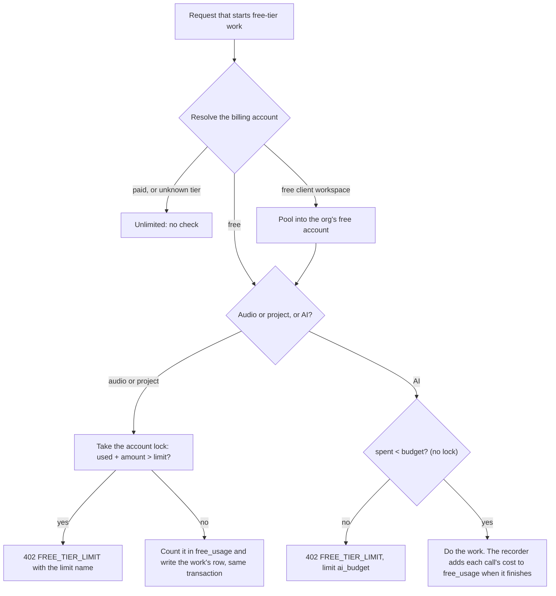
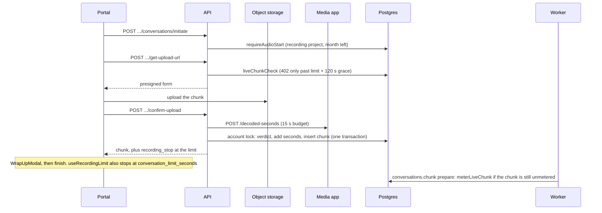
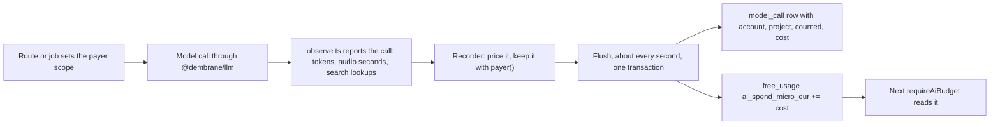
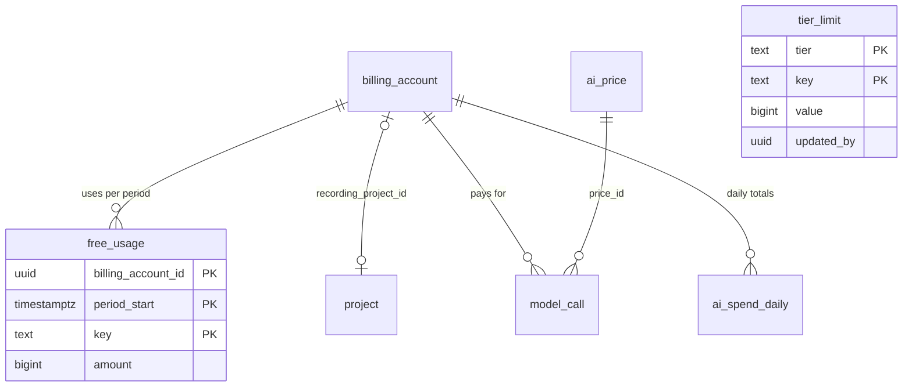

# The free tier in code

A free account gets a monthly allowance: hours of audio and a money budget for AI, plus a project cap. Both monthly meters live in one ledger in Postgres, `free_usage`, one row per account, period and key. Paid accounts are never limited.

- **Audio and projects** are counted before the work, under one lock per billing account.
- **AI** is a budget in euros (default EUR 5 a month, `ai_budget_micro_eur` = 5,000,000). Every AI call, on every tier, is recorded with its cost and the account that pays. A free account's AI work is refused once its spend reaches the budget. There is no per-feature count: no chat, turn, report, map or popcorn limit.

The core is the `allowance` capability in `dembrane/platform/packages/allowance/src/`. Recording and pricing calls is the `metering` capability (`packages/metering/src/`). The namespaces call `allowance` where the work starts. The previous lifetime one-hour lock is retired: `is_over_cap` no longer locks a conversation.

Money is integer micro-euros everywhere: rows, ledger, limits and overrides (EUR 1 = 1,000,000). The staff screens show and accept euros. Customers never see euros: the dashboard shows a percentage, and the 402 body carries only `percent` and `resets_at`.

## The two rules



- Audio and projects: count the unit in the same transaction as the row it pays for. Then a crash leaves either both or neither. Deleting things never refills the ledger. Projects are the exception: they are a live count.
- AI: the check reads spent and limit without the lock, and the cost is known only after a call finishes. Two calls at once, or the last call of the month, may take the account slightly past its budget. That overshoot is accepted. There are no give-backs: a failed or cancelled call still spends what it used.
- Started work finishes. A chat reply, a report or an analysis run is never cut off because the budget reached zero. The assistant is the only work checked between steps.

## The allowance

| Concept | Where | How it works |
|---|---|---|
| Who is free | `isFreeTier` in `free.ts` | The tier is exactly `"free"`. Every other tier, `null` or a missing account is unlimited. This is the only "is free" check. |
| Which account pays | `allowanceForWorkspace`, `allowanceForProject` in `account.ts` | The workspace's own billing account. If that account is free and has no `org_id` (a client workspace), and the org's oldest live billing account is also free, usage pools into the org's account. Returns `null` for unlimited. |
| Counted projects | `allowanceForCountedProject` | As above, but `null` for a sample project. The AI budget check uses this, so samples are never refused for AI. |
| Which account pays for AI, any tier | `payingAccountsForProjects`, `payingAccountsForWorkspaces` in `payer.ts` | The same pooling rule without the free-only filter, batched. Paid accounts resolve too, so their spend is recorded. A sample project resolves with `counted: false`. A soft-deleted project or workspace still resolves to its account, so a call that finishes just after a delete is charged. |
| The period | `periodStart` in `period.ts` | The UTC calendar month. A free account downgraded this month counts from `downgraded_at` instead, so it starts that day with the full budget. Every period resets on the 1st at 00:00 UTC (`nextReset`). |
| The limits | `freeLimits` in `limits.ts` | Rows in `tier_limit` (tier `free`) overlay `FREE_LIMIT_DEFAULTS`. Cached for 60 seconds per process. A failed read serves the defaults without caching them. |
| The AI budget | `aiBudgetFor`, `aiBudgetForProject`, `aiBudgetForWorkspace`, `requireAiBudget`, `requireAiBudgetForWorkspace` in `budget.ts` | Reads the period's `ai_spend_micro_eur` and the limit. `exhausted` is `enforced && limit !== null && spent >= limit`. `percentUsed` is floored and capped at 100. `require*` throw the 402 `ai_budget` when exhausted. |

`downgraded_at` is stamped by a workspace tier change, by `billing.expire-tiers` and by a staff tier move (`tierMovePatch` in `staff/src/routes.ts`).

### The limits and their defaults

Staff can change the first six on the free limits page. The rest are fixed in code.

| Limit key | Default | Counted as | 402 `limit` |
|---|---|---|---|
| `audio_seconds_month` | 18000 (5 hours) | ledger `audio_seconds` | `audio_month` |
| `audio_seconds_conversation` | 3600 (1 hour) | sum of `conversation_chunk.audio_seconds` | `audio_conversation` |
| `projects` | 1 | live non-sample projects across the account's workspaces | `projects` |
| `ai_budget_micro_eur` | 5000000 (EUR 5) | ledger `ai_spend_micro_eur`, written by the recorder | `ai_budget` |
| `ai_budget_enforce` | 1 | the emergency off switch: 0 skips every AI budget check | none |
| `popcorn_cadence_minutes` | 5 | the live cadence floor | none |
| One free organisation per manager | fixed | orgs the user owns or admins | `organisations` |
| One recording project per account | fixed | `billing_account.recording_project_id` | `recording_project` |
| Sample project chat turns | 10 (`FREE_TIER_MAX_SAMPLE_USER_TURNS`) | user messages across the sample's chats | `chat_turns` |
| Sample project reports | 1 | reports in the sample project | `report` |

### The per-account override

Three columns on `billing_account` give one account its own budget: `ai_budget_micro_eur` (an amount), `ai_budget_unlimited` (no limit) and `ai_budget_until` (optional end). While `ai_budget_until` is null or in the future, `ai_budget_unlimited` wins, then the amount; after it, the account is back on the default. It sits on the paying account, so a pooled client workspace uses its organisation account's override. A no-limit account is still recorded and shows in the staff cost view; only the check is skipped. Audio, project and the other free limits still apply to it. The override is read on every check, with no cache.

### The off switch

`tier_limit` `ai_budget_enforce = 0` makes `enforced` false for every account: nothing is refused for budget, and every call is still recorded and priced. It takes effect within a minute through the limits cache, with no restart or deploy.

## The ledger and the lock

`free_usage` holds one row per `(billing_account_id, period_start, key)`. The functions are in `ledger.ts`.

| Function | Does |
|---|---|
| `withAllowanceLock(db, a, fn)` | One transaction holding `pg_advisory_xact_lock(hashtext('free_usage:<account id>'))`. The lock is per account, not per period, because the project cap spans periods. |
| `take` | Refuses when `used + amount` would pass the limit, else adds. Takes the lock itself. |
| `add` | Adds without a limit check. Used for live chunks, which have their own grace. |
| `giveBack` | Subtracts, never below zero. |
| `usedThisPeriod` | Every meter for the account's current period: `audio_seconds` and `ai_spend_micro_eur` (`USAGE_KEYS`). |
| `claimOnce` | Inserts a marker key (`notice:audio_out`, `notice:ai_out`) once per account and period. |

The recorder writes `ai_spend_micro_eur` for every tier, so the staff view covers paid accounts too. It adds without the lock (see [Recording every AI call](#recording-every-ai-call)).

## Where each limit is enforced

### Audio

All audio rules are in `conversations/src/free-audio.ts`.

- **Starting**. `requireAudioStart` runs on the portal's `initiate` for any source but `PORTAL_TEXT`. It refuses a project that is not the recording project, a month already used up, and an account whose AI budget is used up (`ai_budget`). A `PORTAL_TEXT` start gets `requireTextStart` instead: it records nothing, so only a used-up AI budget refuses it (402 `ai_budget`, no figures), and the portal shows `NotTakingRecordings` in text mode ("This project isn't taking responses right now.", id `participant.not_taking_responses`). In text mode the start page shows that screen up front when `is_ai_available` is false. `upload-text` runs `textChunkCheck`, typed text's version of the live chunk rule: at zero, text in a conversation still in progress stamps `ai_stopped_at` and is accepted with `recording_stop: "ai_budget"` for `LIVE_GRACE_SECONDS`, then refused with a 402. A conversation that is finished and finalized (`isClosed`: `is_finished` and transcribed or merged, the state a new chunk would reopen) gets no grace: its text is refused at once, and so is its audio (`liveChunkCheck` and `confirmLiveChunk` refuse `ai_budget` for it), so a reopened link never re-summarises at zero. The text page clears its box only once the text is accepted; after a refusal or a stop it shows the same screen and keeps the unsent text read-only with a copy button. Like the audio page, it shows the screen up front only before anything was sent. A finish with nothing new since the last summary runs no second summary: `claimFinish` only acts on an unfinished conversation, and only a new chunk reopens one. A live recording that `initiate` let through then gets `liveChunkCheck` on every `get-upload-url`, its first chunk included, so it keeps the grace. Any other conversation's first audio goes through `requireAudioStart` again.
- **The recording project**. `recordingProject` in `allowance/src/recording.ts` picks one on first need: the project with the latest live conversation, else the newest. Samples are never eligible. `GET` and `POST /api/v2/projects/:project_id/recording` (`projects/src/recording.ts`) read it and switch it. Switching needs `settings:manage`.
- **Uploads**. `reserveUpload` runs at `confirm-upload` for every non-live source, dashboard uploads included. It refuses `ai_budget` when the budget is used up. It measures the file with `measureSeconds` (`audio/src/measure.ts`, which asks the media app's `POST /decoded-seconds`). A file over the per-conversation limit plus one second is refused. Then, under the lock, it takes the month's seconds, checks the conversation's total and inserts the chunk in the same transaction. A refused file is deleted from the bucket. A measuring failure is a 503 `upload.measure_failed`, so the client retries. An unreadable file is a 400 `upload.unreadable`.
- **Live chunks**. `confirmLiveChunk` measures, then checks and counts under the lock in the transaction that writes the chunk. Below the limit it adds the seconds. At the limit it still accepts the chunk and returns `recording_stop`. Only past the limit plus `LIVE_GRACE_SECONDS` (120) does it refuse with a 402. A "live" chunk over 90 seconds is treated like an upload.
- **Fail open**. If measuring or the limit read fails, a live chunk is written with `audio_seconds` null. The pipeline's `prepare` step then counts it with `meterLiveChunk`, in the month the chunk landed. Only a chunk under 1 MB may pass unmeasured; a larger one retries. A chunk refused there is marked with the error `FREE_LIMIT_SKIPPED` and is never transcribed or merged.
- **AI budget during a live recording**. When the budget is used up, `confirmLiveChunk` stamps `conversation.ai_stopped_at`, keeps the chunk and returns `recording_stop: "ai_budget"`. Chunks within `LIVE_GRACE_SECONDS` (120, wall clock) of that stamp are kept with the same stop; later ones are refused with a 402 `ai_budget`. `liveChunkCheck` and `liveStopNow` answer `ai_budget` too. The portal shows the same "That's a wrap" as at the hours limit.
- **Audio already accepted** is always processed: no budget check in the transcription, final-transcript or summary jobs. Their cost may take the account past its budget.
- **Voice input** never counts against the audio hours. See [the AI budget](#where-the-ai-budget-is-checked).



The portal's project read (`GET /api/participant/projects/:project_id`) carries `is_taking_recordings` and `conversation_limit_seconds` from `audioOpen` (closed when the AI budget is used up too), and `is_ai_available` (false when the budget is used up) for Verify and Explore.

### Projects and organisations

- `requireProjectRoom` (`allowance/src/projects.ts`) runs inside `withAllowanceLock` together with the project write. It guards create (`tenancy/src/service/projects.ts`), `cloneProject` and `moveProject` and `bulkMoveProjects` through `moveUnderCap` (`projects/src/projects.ts`). A move counts only projects coming from another account. Staff skip it.
- `orgService.create` (`tenancy/src/service/orgs.ts`) refuses a new organisation when the user already owns or admins an org whose pooled account is free. The check repeats under `lockOrgCreate`, the per-user lock that onboarding also takes (`withOrgCreateLock`). The 402 carries that org's `org_id` and `workspace_id`, so the wall upgrades it. Staff skip it.

### Where the AI budget is checked

Every entry point the team starts calls `requireAiBudget(projectId)` (or the workspace variant) before any model call, and gets the 402 `billing.tier_limit` with `limit: "ai_budget"`. Paid accounts, sample projects, no-limit overrides and the off switch never refuse.

| Work | Where | At zero |
|---|---|---|
| Chat: new chat, message, suggestions, initialize mode | `freeChats` in `chats/src/free.ts` (`canStartChat`, `admitTurn`), `chats/src/service.ts` | 402. `undoTurn` removes the stored message when a reply fails. |
| Assistant | `admitHostTurn` in `agentic/src/runs/service.ts`; `TurnDeps.budgetLeft` in `agentic/src/runs/turn.ts` | 402 on a new turn. A turn checks before every step, the first included unless its message was admitted less than 30 seconds before (`ADMIT_FRESH_MS`: the admit just checked); at zero it writes "This month's AI budget is used up, so I stopped here. ..." and ends `completed`. A run without a chat is allowed. |
| Report | `createReport` in `projects/src/reports.ts`; the guard step in `reports/src/jobs.ts` (`GenerateDeps.budgetLeft`) | 402 on create or schedule. A scheduled report that comes due at zero ends in error `AI_BUDGET_USED_UP`, "This month's AI budget is used up.", with no model call, and logs `task_create_report.failed`. The report page shows that code translated (`reportErrorText` in `components/report/reportError.ts`; the latest-report read returns `error_code`). |
| Map: generate, title, groups, fact-check | `map/src/service.ts` | 402 when a model call or job would start, including a regenerate of a finished map. A map still generating (queued, waiting or running), and cached titles, groups and fact-checks, return without a check, so a reader at zero still sees existing results. |
| Analysis page run | `requestAnalysisRun` in `analysis/src/bff.ts` | 402. Publication retries of a run that already ran continue at zero. |
| Popcorn: refresh, re-run, go live, resume | `popcorn/src/routes.ts`, `PopcornAllowance` in `popcorn/src/free.ts` | 402. A tick at zero (reads and translation-only ticks alike) calls `pauseUsedUp`: the loop goes back to manual and a `no_op` run "AI budget used up" is written. It stays manual after the reset. |
| Canvas: refresh, preview, scheduled ticks | `canvas/src/service.ts`, `prepareTick` in `canvas/src/ticks.ts` | 402 on refresh and preview. A scheduled tick at zero records a `no_op` "Skipped: the AI budget is used up" and the schedule keeps firing, so it resumes on its own after the reset. |
| Present | `present/src/map.ts` | The room's map request skips the generation and keeps the map it has. `requestGeneration` answers false then, and popcorn keeps the map owed (its `map_fingerprint` does not move), so the first read after the reset asks for the map again. The host sees `AiBudgetNotice` (popcorn) and `MapFreeNotice` (the presented map). |
| Verify and Explore (portal) | `requirePortalAi` in `conversations/src/portal-ai.ts`, called from `verify/src/service.ts` and `conversations/src/v1/routes.ts` | 403 `portal.ai_unavailable`, "Not available right now.", with no plan words. |
| Retranscribe | `conversations/src/v1/audio-routes.ts` | 402. |
| Summary and title (host) | `POST /api/conversations/:id/summarize` and `/generate-title` in `conversations/src/v1/routes.ts`; `updateConversation` in `conversations/src/bff/service.ts` | 402 after the access check. A `PATCH /api/v2/bff/conversations/:id` that clears an existing summary (to empty or the no-transcript placeholder, the values the summary catch-up rewrites) is a regenerate, so it gets the same 402; edits to the text, blank text, and saving an empty summary that was already empty, are not checked. The dashboard's edit modal sends `summary` only when the host edited it, opens the AI wall (`summary_again`) on that refusal, puts the summary back and saves the other fields. The pipeline's own summary of accepted audio is not checked. |
| Recording and uploads | `conversations/src/free-audio.ts` | See [Audio](#audio). |
| Voice input | `POST /api/stateless/transcribe`, `conversations/src/stateless/service.ts` | With `project_id`: 402 (the project pays). Without one, the form's `workspace_id` pays (the caller must be a member) and `pricing_intake` refuses at zero. `pricing_intake` without a `workspace_id` is billed to the caller's own workspace (their default one, else their first; support access does not count) and refuses at zero the same way; a caller with no workspace gets 403 `access.not_onboarded`. `issue_report` never checks the budget, with or without a project, so issue reports always work; each purpose is rate-limited per person (30 an hour). Voice never counts against the audio hours. |

Popcorn and present host payloads carry `ai_budget: { exhausted } | null`; the audience bundle carries nothing. The kept popcorn rules are not counts: the live cadence floor (`popcorn_cadence_minutes`, paid loops keep 1 minute), free finish-reads only while live or booked (`queueFinishRead`), and `MAX_FAILED_READS` (3).

The old counts are gone: `freeChats` claims and the per-chat cap, the frozen-chat rule, the run-needs-a-chat rule, `takeFreeReport` and the report give-backs, `startFreeMap`, `popcornAllowance` counting and its give-backs, `FREE_UNITS` and `refundFailedRuns` in analysis, and `charge.ts`. The stamp columns (`free_period_start`, `free_account_id`) are no longer written; dropping them is a later contract migration.

### Samples and paid accounts

- Sample projects are never counted and never count toward the project cap. They cannot be the recording project, so they take no audio. Their AI calls are recorded as `payer = 'account'` with `counted: false`: they show in the staff view's cost for the account, but the recorder adds nothing to `free_usage`, so they never count toward the budget or "Used". A free sample keeps its own caps: 10 chat turns and one report.
- For a paid or unknown tier every `allowanceFor*` and `aiBudgetFor*` call returns `null`. Each check returns before it reads a limit. The recorder still writes their spend, for the staff view.

## Recording every AI call



### Who pays: the payer scope

`withPayer(payer, fn)` and `payer()` in `packages/observability/src/payer.ts` hold an AsyncLocalStorage payer next to the correlation context. It is for metering only, never for access control. A payer is a reference (`project`, `conversation`, `chat`, `agent_run`, `report`, `canvas`, `verify_artifact`, `popcorn_loop`, `analysis_run` or `workspace`, with an id) or `{ internal: "<reason>" }`.

- **API**: `payerMiddleware` (`apps/api/src/middleware/payer.ts`) scopes each request by its first route param, in the order `project_id`, `conversation_id`, `chat_id`, `run_id`, `report_id`, `canvas_id`, `artifact_id`, `loop_id`, `workspace_id`. Some params mean different ids on different routes: `run_id` is an `analysis_run` under `/api/v2/bff/analysis/` and an `agent_run` under `/api/agentic/runs/` (nothing elsewhere); `canvas_id` is the canvas's `project_report` id, so it pays as `report` (the `canvas` kind is the canvas jobs' `agent_loop` id); a `report_id` under `/api/v2/feedback/` is a feedback report and names no payer. Body-addressed routes (Verify generate, assistant runs, chat creation, canvas preview, voice input) wrap their AI part in `withPayer` themselves.
- **Jobs and workflows**: `defineJob(name, schema, { payer: (payload) => ... })`. The queue's `wrap` runs the handler inside that scope for `work()` and `workflow()`, DBOS recovery included. A job can run in another process than the request that queued it, so nothing carries over. Jobs that span projects scope per item: the summary catch-up per conversation, popcorn per loop.
- **Internal**: staff demo building (`demo_build`), voice with no project and no workspace, and dev tools. Recorded as `payer = 'internal'`, never charged.

A call outside any scope is saved with `payer = 'unattributed'` and logged once per operation per process ("model call without a payer"). That is a defect. The tests catch it (below); in production the staff view shows unattributed spend and the daily rollup posts to Slack when yesterday's share passes 1%.

### What the observer reports

`packages/llm/src/observe.ts` sees every chat, stream, embedding and speech call (`FallbackModel`, `observedEmbedding`, and `compat.ts` for Scaleway). On top of input and output tokens it reports cached input, reasoning and audio input tokens, audio seconds for speech-to-text and Google Search lookups for grounding.

- A stream that errors or is cancelled (a user pressing stop) keeps the usage the provider already sent. Where it sent none, the observer estimates it and flags the row `usage_estimated`: text input with tiktoken cl100k, audio input from its duration, output from the text streamed so far. Thinking tokens never stream, so a cancelled call's reasoning is under-counted.
- A generate call that fails after the provider accepted it is estimated the same way. A call refused before it reached the provider costs nothing.
- Whisper on Scaleway (`transcribeAudio`, `transcribeSegments`, `audioToText` in `compat.ts`) is billed in audio seconds, on the duration the provider returns when it is a finite number, else on the request-side figure, flagged estimated.

### The recorder

`modelCallRecorder` in `packages/metering/src/index.ts` prices each call when it is observed, keeps it with its payer, and flushes about once a second. One transaction per flush (`modelCallTable`):

1. Resolve payer references to a project or workspace (`resolve.ts`), then to the paying account (`payingAccountsFor*`). Cached for 60 seconds.
2. Set `billing_account_id`, `project_id`, `counted` and `payer` (`account`, `internal` or `unattributed`) on each row and insert into `model_call`.
3. Add each account's cost to `free_usage` (`ai_spend_micro_eur`) under `periodStart(second, tier, downgradedAt)`. Spend is summed per payer and UTC second, so a call even seconds after a downgrade lands in the free period. Uncounted (sample) and internal spend is skipped.

The monthly total is written in the same transaction as its rows. If the database is down, rows go back to the buffer (capped at 2,000; the oldest are dropped with a loud log), but the per-account spend totals are never dropped and are written when it returns. During an outage the unsaved spend map holds one entry per payer per second with spend, still never dropped. Rows may be lost; money isn't. A crash loses at most the unflushed second. A write slower than the flush interval never stalls the ones after it. `flush()` keeps writing (up to 5 rounds) until nothing is pending, and never returns while a write is still running, its own or a timer's, so calls that arrive during the last write are kept too. API and worker await it on shutdown before they close the database pool. While the price book is still empty, a call with usage is held, never written with a cost computed from no prices.

## Prices

| Piece | Where | Does |
|---|---|---|
| Overrides | `packages/metering/prices/overrides.json` | Hand-kept and always wins. Maps each configured model to its models.dev key (`google-vertex/<id>`), and holds hand prices: the Scaleway models in euros (GLM, Whisper per audio second, the Qwen embedding), Vertex `text-embedding-004`, and Google Search grounding per lookup. A test fails when a configured model has no entry. `loadOverrides` refuses an unknown key, a unit price that is not a number or null, and a hand price with no unit above 0, so a typo can't price a unit at 0. |
| Pricer | `priceCall` in `prices/pricer.ts` | Text, cached, audio and output tokens at their unit prices, plus audio seconds and search lookups. Above a model's long-context threshold the long prices apply to the whole call. Dollars convert at the stored rate. Rounds up to whole micro-euros. |
| Missing price | `priceCall`; `modelCallRecorder` | Charged with the most expensive price held for the same unit and flagged `price_missing`. The recorder logs `metering.price_missing` and posts the model to Slack the first time each process prices it without a row, so every API and worker replica posts once per model. |
| Price book | `priceBook` in `prices/store.ts` | Every process holds the latest `ai_price` row per model and the exchange rate in memory, reloaded after each sync and every 5 minutes. Pricing a call never reads the database. |
| Daily sync | `syncPrices` in `prices/sync.ts`, job `metering.price-sync` | Downloads models.dev (`MODELS_DEV_URL`), keeps only configured models, applies the overrides, and inserts a new `ai_price` row only when a unit price changed. A price that disappears or drops to zero is rejected and the last good one kept. A failed download changes nothing. Reads the ECB euro reference rate (`ECB_RATES_URL`) into `ai_fx_rate`, keeping the last good rate on failure. A rate outside 0.5 to 2 EUR per USD is rejected: the last good rate stays, with an error log (`metering.fx_rejected`) and a Slack post. A move of more than 2% from the last stored rate is posted to Slack. A model's first stored price is not posted (a fresh preview database would post every model); later price changes are. |
| Startup check | `priceStartup` in `prices/sync.ts`, from API and worker `main.ts` | Await `book.reload()`. If any configured model (model groups, transcription profiles, embeddings) has no stored price, as after a deploy that adds one, start a sync in the background. Every configured model still without a price after it is logged as an error and posted to Slack (`missingPriceText`), with the fix: an overrides entry for a model not in `overrides.json`, the next sync when models.dev could not be read or the sync failed, a hand price when models.dev does not list it. The post says calls are held when no prices are stored at all, else charged at the highest price held. |
| Slack | `postSlack` in `slack.ts`, `AI_COST_SLACK_WEBHOOK_URL` | Every price change ("Large change: " above 3x or below a third), rejected prices, missing prices and the unattributed alert. Unset is off. |

A call's cost is fixed when it is recorded. Later price changes never rewrite past spend.

Checking against the real bill is a manual step: monthly for the first three months, then quarterly, compare last month's per-provider totals on the staff "AI costs" page with the Google (Vertex AI, cost before credits) and Scaleway (Generative APIs) invoices. A gap above about 5% means the prices or the recording need fixing.

## The 402 and the dashboard

Every refusal is `freeLimitError(limit, params)` from `allowance/src/errors.ts`: a `PaymentRequiredError` with code `billing.tier_limit`. An AI budget refusal is:

```json
{
  "code": "billing.tier_limit",
  "params": { "limit": "ai_budget" },
  "detail": { "percent": 100, "resets_at": "2026-12-01T00:00:00.000Z", "error": "FREE_TIER_LIMIT", "limit": "ai_budget", "upgrade_cta_tier": "changemaker" }
}
```

It carries no euros: the body reaches the browser. Other limits carry their own `detail` fields (`used` and `cap`, `remaining_seconds`, `file_seconds` and `limit_seconds`, or `org_id`).

The free allowance snapshot (`allowanceSnapshot` in `snapshot.ts`, `GET /api/v2/workspaces/:workspace_id/free-allowance`) returns `audio_seconds`, `projects` and `ai: { percent_used, exhausted, unlimited, enforced } | null`. `enforced` is false while staff turned the check off (`ai_budget_enforce` = 0); `exhausted` is then always false. The workspace read's `free_tier` block is `{ active, ai_percent_used, ai_exhausted }`.

In `dembrane/frontend/src`:

| What | Where |
|---|---|
| Reading the 402 | `isFreeTierLimitError`, `freeLimitDetails`, `aiBudgetDetails`, `portalRecordingRefusal` and `recordingStopOf` in `lib/freeTier.ts`. Any 402 with `limit: "ai_budget"`, from any call site, is recognised. |
| The AI popup | `AiBudgetWall` and `useAiBudgetWall` (`components/workspace/AiBudgetWall.tsx`). One wall (`WallKey` `ai_budget`) for every AI action; `aiActionLine` in `gateWalls.ts` names the action tried. It opens `PricingConfigurator` with the `ai_budget` block ("This month's AI budget is used up.", the reset day in UTC), or the neutral `ai_allowance` opening when the budget still has room. `openFor` also calls `invalidateFreeAllowance`, so the meter and banners catch up with any refusal. Opened used up with no refused action (the allowance card's banner), it keeps the `ai_budget` block and uses the allowance opening, with no attempt line. |
| Sample project caps | `SampleCapWall` (`components/workspace/SampleCapWall.tsx`): its own `WallKey` `sample_cap`, never the AI budget's. It opens `PricingConfigurator` with the `sample_cap` opening: "Sample projects allow 10 questions." (the number is the `cap` the chat_turns 402 carries, 10 when absent) or "Sample projects allow one report.", then "Create your own project to keep going, or answer 5 quick questions and pick a time with the dembrane team for a paid plan." No attempt line and no "requires a paid plan". |
| Other walls | A `WallKey` per limit in `components/workspace/gateWalls.ts`, opened through `UpgradeModal` in `components/workspace/FeatureGate.tsx` |
| The meter | `useFreeAllowance` reads the snapshot. `FreeAllowanceCard` on the workspace settings page shows audio, "AI this month" as a percentage (capped at 100) and projects. No percentage for a no-limit account. Call `invalidateFreeAllowance` after AI work. |
| Banners | `FreeAllowanceBanner` with `feature="ai"` on new chat, the report form, the map page and the allowance card: from 80% (inclusive) it warns that recording stops too; at zero it says AI features and new recordings are paused. It shows nothing while `ai.enforced` is false. `AudioUsedUpNotice` on the project home and the conversations panel shows `feature="ai"` when the AI is used up and `feature="audio"` when the hours are. `AiBudgetNotice` on popcorn and present, and `MapFreeNotice` on present when it shows the map, when `ai_budget.exhausted`. `ChatTurnLimitCard` for a sample project's turn cap; its button opens `SampleCapWall`. |
| Voice | `useVoiceTranscription` sends `project_id`, else `workspace_id` and the purpose. The chat microphone is enabled on free; a 402 opens the AI popup. The issue report dictation (`ReportIssueModal`) sends only `workspace_id` and `issue_report`, so a project viewer is not refused for lacking `project:update`. |
| Recording | `useProjectRecording` and `RecordingPausedNotice` on a project that is not the recording project. The upload dropzone prechecks lengths with `readMediaSeconds` and `precheckUploads`; `uploadRefusalMessage` words a refused file, an `ai_budget` refusal with the allowance's reset day. |
| Portal | `NotTakingRecordings` (never mentions plans), `WrapUpModal` on `recording_stop` (`ai_budget` reads like the hours limit) or the conversation limit, `AiUnavailableText` ("Not available right now", `components/participant/AiUnavailable.tsx`) on Verify and Explore when `is_ai_available` is false, or when the server answers `portal.ai_unavailable` (`isAiUnavailableError`) |

`useAllowanceApplies` treats sample projects as exempt. `audioUsedUp` counts under 60 seconds left as used up, to match the notice job.

## Staff

- `GET /api/v2/admin/free-limits` and `PUT /api/v2/admin/free-limits/:key` in `staff/src/routes.ts`. A value is a whole number from 0 to a per-key maximum: `ai_budget_micro_eur` up to 1,000,000,000 (EUR 1,000), `ai_budget_enforce` 0 or 1, the others 10,000,000.
- `PUT /api/v2/admin/billing-accounts/:account_id/ai-budget` with `{ amount_micro_eur, unlimited, until }` sets the override (amount 0 to EUR 1,000; `until` an ISO 8601 day or date and time, in the future, on a real calendar day: `2027-02-30` is a 400). The audit records what was stored, so `unlimited` audits no amount. `DELETE` on the same path clears it.
- `GET /api/v2/admin/ai-costs?month_offset=0|1` (`staff/src/ai-costs.ts`): cost per billing account on every tier, with `by_feature` and `by_model`, the free accounts' budget and percentage, no-limit accounts marked, `unattributed_micro_eur` and `by_provider`. Both months read `ai_spend_daily` for the days already rolled up and `model_call` for the days not rolled up yet, so no call counts twice. A downgraded account's cost adds both periods of the month; its budget fields read the free period only. A soft-deleted account (`deleted_at` set) is still a row, with `deleted: true`; the page marks it "Deleted".
- All need `staff:set_tier`. Every read and change is written to `staff_audit_event` (`free_limit.read`, `free_limit.update`, `billing_account.ai_budget.set`, `billing_account.ai_budget.clear`, `ai_costs.read`). `tier_limit.updated_by` keeps who changed a limit last.
- Screens: `FreeLimitsPanel` at `/admin/free-tier-limits` (audio in minutes, the budget in euros with two decimals, the off switch), `AiBudgetEditor` in the account actions, `AiCostsPanel` at `/admin/ai-costs`. The editor's "Until" is the last day on the budget, inclusive: it stores 00:00 UTC of the day after. Its earliest day is today's UTC date. The AI costs page shows the same last covered day ("EUR 20.00 until Dec 31, 2026").
- A limit save clears the limits cache in the process that served it. Other processes pick it up within a minute. An override applies on the next check.
- The at-risk list includes free workspaces at their monthly audio limit.

## Background jobs

| Job | Every | Free tier work |
|---|---|---|
| `billing.free-audio-out` | 5 minutes | Tells a free account's admins once per period that the month's recording hours are used: a `FREE_AUDIO_OUT` notification and an email. Runs only with `BILLING_CUSTOMER_JOBS=on` (default `off`). |
| `billing.free-ai-out` | 5 minutes | The same for the AI budget: once per period (`notice:ai_out`), a `FREE_AI_OUT` notification and the email "{name} has used this month's AI budget". Skips no-limit accounts and the off switch. Same `BILLING_CUSTOMER_JOBS` guard. |
| `metering.price-sync` | daily, 03:15 UTC | The price sync above. Also runs at startup when a configured model has no stored price. |
| `metering.spend-rollup` | daily, 00:30 UTC | Rolls the last 3 complete UTC days of `model_call` into `ai_spend_daily` (calls, tokens and euros per day, account, payer, feature and model; replacing those days, so it is idempotent and a missed run heals). Also backfills any older day that has calls but no totals. Deletes `model_call` rows older than 90 days in batches. Posts to Slack when yesterday's unattributed share passes 1%. |
| `reports.backfill-scheduled` | 5 minutes | Also runs `failStuckReports`: free non-sample drafts older than 2.5 hours end in error (`GENERATION_DID_NOT_FINISH`). Nothing is given back. |
| `popcorn.reconcile-ticks` | 1 minute | Also runs `settleStuckRuns`, which ends runs that a pre-budget free tick left `running` in error. |
| `conversations.chunk` | per chunk | `prepare` counts unmetered live chunks with `meterLiveChunk`. |

`ai_spend_daily` is kept forever, so cost history survives the 90-day row cleanup. Grafana's `obs.day_ai_spend` view reads it; the shorter `obs` call views stay on `model_call`.

## Database changes



`model_call` gains `provider`, `billing_account_id`, `project_id`, `payer`, `counted`, `cached_input_tokens`, `audio_input_tokens`, `reasoning_tokens`, `audio_seconds`, `search_queries`, `usage_estimated`, `price_missing`, `cost_micro_eur` and `price_id`. `ai_price` holds each model's unit prices with the date they took effect and their source (`models.dev` or `override`); `ai_fx_rate` the daily dollar to euro rate. `conversation.ai_stopped_at` holds when a live recording got its AI budget stop. `conversation_chunk.audio_seconds` holds what a chunk counted.

Stamps from the old counts still sit on their rows and are no longer written: `project_chat.free_period_start`; `free_period_start` and `free_account_id` on `project_report`, `agent_loop_run` and `analysis_run`.

| Migration | Does |
|---|---|
| `0028_expand_free_tier_allowance` | Creates `free_usage` and `tier_limit`. |
| `0029_expand_clear_over_cap` | Clears every `is_over_cap` stamp left by the retired lock. |
| `0030_expand_free_tier_recording` | Adds `billing_account.recording_project_id` and `conversation_chunk.audio_seconds`. |
| `0031_expand_free_limit_keys` | Deletes retired limit keys and `popcorn_sessions` usage rows. |
| `0032_expand_free_chat_period` | Adds `project_chat.free_period_start`. |
| `0033_expand_free_report_period` | Adds `project_report.free_period_start`. |
| `0034_expand_free_popcorn_run` | Adds `agent_loop_run.free_period_start`. |
| `0035_expand_free_tier_launch_backfill` | Counted the launch period's audio, chats, reports, maps and popcorn analyses into `free_usage`. |
| `0036_expand_free_account_stamp` | Adds `free_account_id` to `agent_loop_run` and `project_report`, and fills it on stamped rows. |
| `0037_expand_free_analysis_run` | Adds the stamp columns to `analysis_run`, plus indexes for the popcorn stuck-run sweep and the failed-run refund. |
| `0045_expand_ai_spend` | Adds the `model_call` cost columns, `ai_price`, `ai_fx_rate` and `ai_spend_daily`. No new `model_call` index. Seeds `ai_budget_micro_eur` (5,000,000) and `ai_budget_enforce` (1). |
| `0046_expand_ai_spend_views` | Creates `obs.day_ai_spend`. |
| `0047_expand_ai_recording_stop` | A no-op (`SELECT 1`): its `conversation.ai_stopped_at` moved into 0048. |
| `0048_expand_retire_free_counts` | Deletes the `chats`, `reports`, `maps` and `popcorn_analyses` ledger rows and their five `tier_limit` keys, then adds `conversation.ai_stopped_at` and, last, the `billing_account` override columns. The hot tables come last on purpose: all pending migrations run in one transaction, so the only lock awaited while one is held is `billing_account`'s. `migrate` retries the whole run on a lock timeout (55P03) or a deadlock (40P01). Safe to run twice. |

## Deploying

- The `migrate` app runs all pending migrations in one transaction with `lock_timeout` set to 5 seconds. A lock timeout rolls the whole run back, and it is tried again up to 3 times (`packages/db/src/migrate.ts`).
- `0035` is safe to run twice. Its inserts keep the larger amount on conflict, and it stamps only rows with no stamp yet.
- Every free account starts with a full budget at launch: there is no spend backfill.
- If the budget blocks people by mistake, set `ai_budget_enforce` to 0 on the staff free limits page. No deploy, no Argo sync.

## Adding a new limit

1. Add the key and its default to `LIMIT_KEYS` and `FREE_LIMIT_DEFAULTS` in `allowance/src/limits.ts`, and its maximum to `KEY_MAX` in `staff/src/routes.ts` if it is not 10,000,000. Add it to `FreeLimitKey` in `hooks/useFreeLimits.ts` and give it a label and unit in `FreeLimitsPanel`.
2. If it is a monthly count, add a ledger key to `USAGE_KEYS` (`ledger.ts`) and a meter to `allowanceSnapshot` (`snapshot.ts`) and the frontend `FreeAllowance` type.
3. Add the 402 name to `FreeLimitName` (`errors.ts`) and to `FreeTierLimit` in `lib/freeTier.ts`. Add it to the `billing.tier_limit` description in `core/src/catalog/billing.ts` and run `pnpm errors:sync` in `dembrane/frontend`.
4. Enforce it where the work starts. Resolve with `allowanceForCountedProject` (or `allowanceForWorkspace`). Take inside `withAllowanceLock` in the same transaction as the work's row. Throw `freeLimitError` on refusal.
5. Add a `WallKey` with its popover and action lines in `gateWalls.ts`, catch the 402 with `isFreeTierLimitError`, and call `invalidateFreeAllowance` after a spend.
6. Write integration tests next to the namespace: two takes at once, the month boundary, paid and sample projects untouched.
7. A new column is an expand migration. Generate it with `bun run db:generate`.

A new AI feature needs no new limit. Call `requireAiBudget` before its first model call, run it inside a payer scope (a route param the middleware knows, `withPayer`, or a job's `payer` option), and open `AiBudgetWall` with an `AiAction` on the 402. Recording and upload surfaces count as call sites too: an upload refused for `ai_budget` must say so (`uploadRefusalMessage`). A paid-only feature needs no check at all; its calls are still recorded.

## Tests check who pays for AI

Every AI call runs inside a payer scope (`withPayer` from `@dembrane/observability`): API routes and jobs set it where the work starts. The test fakes in `@dembrane/llm` (`fakeModels`, `fakeLanguageModel`, `FakeCompleter`, `FakeEmbedder`) record the payer of each call. A preload (`dembrane/platform/bunfig.toml` loads `scripts/test-preload.ts`) fails any test that made a call without a payer, or whose model observer faulted. A test that reaches a model through a route or a job and fails this way has found an entry point with no scope, so fix the entry point. A test that calls an internal function directly wraps that call in `withPayer`, with the payer its real entry point would set. The preload runs only when tests start from `dembrane/platform`, as CI's `bun test --parallel` does. Running a package's tests from inside its own folder skips the check, so only CI is trusted for it.

## Related

- [Architecture](./architecture.md)
- [The data model](./data-model.md)
- [The processing pipeline](./processing-pipeline.md)
- [Background jobs and schedules](./background-jobs-and-scheduler.md)
- [Chat and the assistant](./chat-and-agent.md)
- [Deployment and releases](./deployment-and-releases.md)
- [Tiers and billing](../../features/tiers-and-billing.md)
- [Tiers and discounts, for staff](../staff/discounts-trials-and-tiers.md): the free limits page and the per-account AI budget
- [Usage, billing and payments, for staff](../staff/usage-and-billing-rollup.md#ai-costs): the AI costs page
