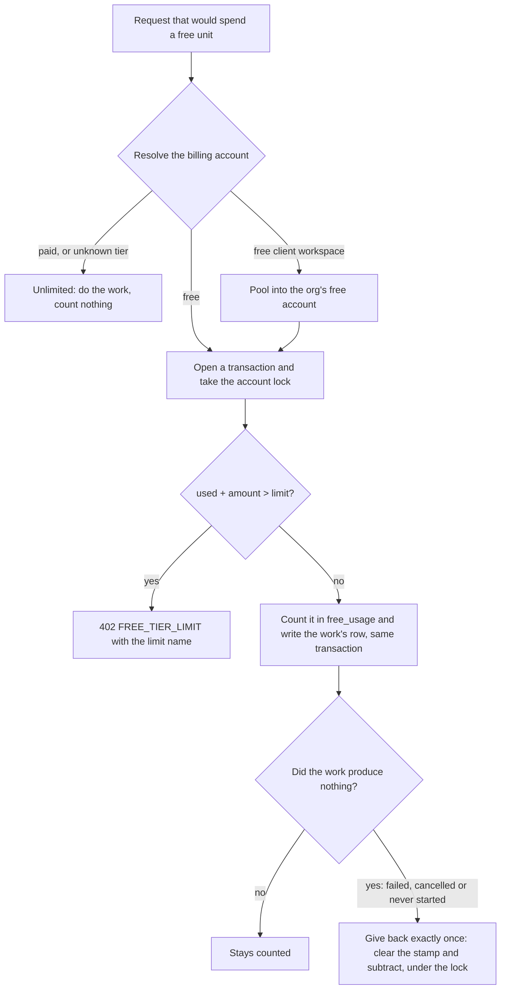
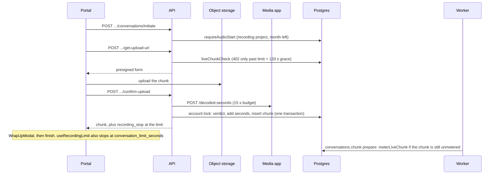
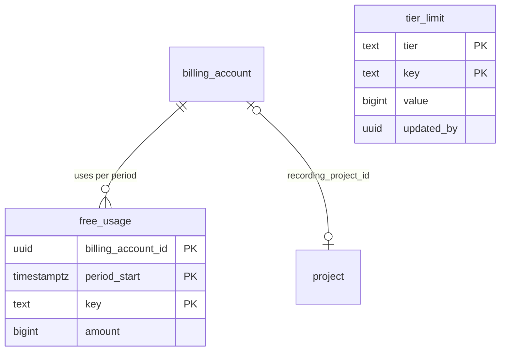

# The free tier in code

A free account gets a monthly allowance: hours of audio, chats, reports, maps and popcorn analyses, plus a project cap. Every limit is checked and counted in one place, a ledger in Postgres, under one lock per billing account. Paid accounts never touch any of it.

The core is the `allowance` capability in `dembrane/platform/packages/allowance/src/`. The namespaces call it where the work starts. The previous lifetime one-hour lock is retired: `is_over_cap` no longer locks a conversation.

## The one rule every limit follows



- Count the unit in the same transaction as the row it pays for. Then a crash leaves either both or neither.
- A row that can be given back later carries a stamp: the period and the account it was taken from. The give-back clears the stamp and subtracts in one locked transaction, so it can run only once.
- A give-back only subtracts when the stamp matches the account's current period and account. A charge from an earlier month is cleared, not refunded into this one.
- Deleting things never refills the ledger. Projects are the exception: they are a live count.

## The allowance

| Concept | Where | How it works |
|---|---|---|
| Who is free | `isFreeTier` in `free.ts` | The tier is exactly `"free"`. Every other tier, `null` or a missing account is unlimited. This is the only "is free" check. |
| Which account pays | `allowanceForWorkspace`, `allowanceForProject` in `account.ts` | The workspace's own billing account. If that account is free and has no `org_id` (a client workspace), and the org's oldest live billing account is also free, usage pools into the org's account. Returns `null` for unlimited. |
| Counted projects | `allowanceForCountedProject` | As above, but `null` for a sample project. Chats, reports, maps and popcorn use this, so samples are never counted. |
| The period | `periodStart` in `period.ts` | The UTC calendar month. A free account downgraded this month counts from `downgraded_at` instead. Every period resets on the 1st (`nextReset`). |
| The limits | `freeLimits` in `limits.ts` | Rows in `tier_limit` (tier `free`) overlay `FREE_LIMIT_DEFAULTS`. Cached for 60 seconds per process. A failed read serves the defaults without caching them. |

`downgraded_at` is stamped by a workspace tier change, by `billing.expire-tiers` and by a staff tier move (`tierMovePatch` in `staff/src/routes.ts`).

### The limits and their defaults

Staff can change the first nine. The rest are fixed in code.

| Limit key | Default | Counted as | 402 `limit` |
|---|---|---|---|
| `audio_seconds_month` | 18000 (5 hours) | ledger `audio_seconds` | `audio_month` |
| `audio_seconds_conversation` | 3600 (1 hour) | sum of `conversation_chunk.audio_seconds` | `audio_conversation` |
| `projects` | 1 | live non-sample projects across the account's workspaces | `projects` |
| `chats_month` | 2 | ledger `chats` | `chats` |
| `chat_turns_per_chat` | 20 | user messages in the chat this period | `chat_turns` |
| `reports_month` | 1 | ledger `reports` | `report` |
| `maps_month` | 1 | ledger `maps` | `map` |
| `popcorn_analyses_month` | 12 | ledger `popcorn_analyses` | `popcorn` |
| `popcorn_cadence_minutes` | 5 | the live cadence floor | none |
| One free organisation per manager | fixed | orgs the user owns or admins | `organisations` |
| One recording project per account | fixed | `billing_account.recording_project_id` | `recording_project` |

## The ledger and the lock

`free_usage` holds one row per `(billing_account_id, period_start, key)`. The functions are in `ledger.ts`.

| Function | Does |
|---|---|
| `withAllowanceLock(db, a, fn)` | One transaction holding `pg_advisory_xact_lock(hashtext('free_usage:<account id>'))`. The lock is per account, not per period, because the project cap spans periods. |
| `take` | Refuses when `used + amount` would pass the limit, else adds. Takes the lock itself. |
| `add` | Adds without a limit check. Used for live chunks, which have their own grace. |
| `giveBack` | Subtracts, never below zero. |
| `usedThisPeriod` | Every meter for the account's current period. |
| `claimOnce` | Inserts a marker key (`notice:audio_out`) once per account and period. |

`charge.ts` wraps the one-unit-per-start pattern for maps and popcorn: `takeFreeUnit`, `requireFreeUnitRoom` (a check only) and `chargeFreeUnit`, which returns a `giveBack` that runs at most once.

## Where each limit is enforced

### Audio

All audio rules are in `conversations/src/free-audio.ts`.

- **Starting**. `requireAudioStart` runs on the portal's `initiate` for any source but `PORTAL_TEXT`. It refuses a project that is not the recording project, and a month already used up. A live recording that `initiate` let through then gets `liveChunkCheck` on every `get-upload-url`, its first chunk included, so it keeps the grace. Any other conversation's first audio goes through `requireAudioStart` again.
- **The recording project**. `recordingProject` in `allowance/src/recording.ts` picks one on first need: the project with the latest live conversation, else the newest. Samples are never eligible. `GET` and `POST /api/v2/projects/:project_id/recording` (`projects/src/recording.ts`) read it and switch it. Switching needs `settings:manage`.
- **Uploads**. `reserveUpload` runs at `confirm-upload` for every non-live source, dashboard uploads included. It measures the file with `measureSeconds` (`audio/src/measure.ts`, which asks the media app's `POST /decoded-seconds`). A file over the per-conversation limit plus one second is refused. Then, under the lock, it takes the month's seconds, checks the conversation's total and inserts the chunk in the same transaction. A refused file is deleted from the bucket. A measuring failure is a 503 `upload.measure_failed`, so the client retries. An unreadable file is a 400 `upload.unreadable`.
- **Live chunks**. `confirmLiveChunk` measures, then checks and counts under the lock in the transaction that writes the chunk. Below the limit it adds the seconds. At the limit it still accepts the chunk and returns `recording_stop`. Only past the limit plus `LIVE_GRACE_SECONDS` (120) does it refuse with a 402. A "live" chunk over 90 seconds is treated like an upload.
- **Fail open**. If measuring or the limit read fails, a live chunk is written with `audio_seconds` null. The pipeline's `prepare` step then counts it with `meterLiveChunk`, in the month the chunk landed. Only a chunk under 1 MB may pass unmeasured; a larger one retries. A chunk refused there is marked with the error `FREE_LIMIT_SKIPPED` and is never transcribed or merged.
- **Voice input**. `POST /api/stateless/transcribe` with a free project (samples included) is refused with `audio_month` before any work (`stateless/service.ts`).



The portal's project read (`GET /api/participant/projects/:project_id`) carries `is_taking_recordings` and `conversation_limit_seconds` from `audioOpen`.

### Projects and organisations

- `requireProjectRoom` (`allowance/src/projects.ts`) runs inside `withAllowanceLock` together with the project write. It guards create (`tenancy/src/service/projects.ts`), `cloneProject` and `moveProject` and `bulkMoveProjects` through `moveUnderCap` (`projects/src/projects.ts`). A move counts only projects coming from another account. Staff skip it.
- `orgService.create` (`tenancy/src/service/orgs.ts`) refuses a new organisation when the user already owns or admins an org whose pooled account is free. The check repeats under `lockOrgCreate`, the per-user lock that onboarding also takes (`withOrgCreateLock`). The 402 carries that org's `org_id` and `workspace_id`, so the wall upgrades it. Staff skip it.

### Chats

`freeChats` in `chats/src/free.ts`:

- `canStartChat` refuses a new chat when the month's chats are used up.
- `admitTurn` stores the user's message under the lock. A chat's first user turn takes a chat and stamps `project_chat.free_period_start`. Later turns are counted against `chat_turns_per_chat`. A chat stamped in an earlier period is frozen (`chat_turns` with `reason: "frozen"`).
- `undoTurn` runs when the reply fails. It removes the message, and gives the chat back if that turn was the claim and no other turn followed.
- The agentic chat uses the same gate (`admitHostTurn` in `agentic/src/runs/service.ts`). A free run with no chat is refused.
- A sample project has its own cap instead: 10 user turns across its chats (`FREE_TIER_MAX_SAMPLE_USER_TURNS`).

### Reports

In `projects/src/free.ts` and `projects/src/reports.ts`:

- `createReport` takes the period's report (`takeFreeReport`) and stamps `free_period_start` and `free_account_id` on the new row. If the insert fails, it gives it back. A sample copy keeps one report of its own.
- `chargeReportChange` charges a status or schedule change. A report that will generate again takes another report, unless its current stamp covers a run that has not happened yet.
- `refundFreeReport` gives back a report that ended in error before saving, or was cancelled before it ran. The generation workflow calls it from `markError`.
- `cancelScheduledReport` cancels and gives back in one locked transaction. Cancel-schedule and deleting a scheduled report use it.
- A stuck draft is swept: `failStuckReports` (`reports/src/jobs.ts`) ends free drafts older than 2.5 hours in error (`GENERATION_DID_NOT_FINISH`) and gives them back.

### Maps

`startFreeMap` (`map/src/free.ts`) wraps `requestGeneration` behind `POST /api/v2/bff/map/projects/:project_id/generate`. A free map still generating answers a second click without counting. The map is given back if starting throws or starts nothing new. A map that started is never given back.

### Popcorn

`popcornAllowance` in `popcorn/src/free.ts`, used by the tick in `popcorn/src/tick/run.ts`:

- A tick that reads (extraction, enrichment, an analysis pass or a re-run) takes one analysis before it starts. A tick that only asks for the map is counted as a map.
- The counted run is written to `agent_loop_run` as `running` with its stamp first, so a crashed attempt can be found.
- When the month is used up, `pauseUsedUp` returns the loop to manual and writes a `no_op` run ("Free analyses used up"). A start booked for later stays.
- A free live loop runs no more often than `popcorn_cadence_minutes`. Paid loops keep the 1 minute floor.
- The analysis is given back when the tick errors, or when it read nothing (every conversation failed and no view was made). An interrupted or stuck run is given back unless the session kept something it read before the loop's next run (`readBetween`). A finished analysis stays counted.
- Free live ticks stop retrying a conversation after 3 failed reads of the same content (`MAX_FAILED_READS`).
- On free, a finished transcript books a popcorn read only while the loop is live or has a start booked (`queueFinishRead`).
- Refresh, re-run, go live and resume refuse with a 402 `popcorn` when the month is used up. Payloads carry `free_popcorn` (used, limit, exhausted).

### The analysis page

`requestAnalysisRun` (`analysis/src/bff.ts`, `POST /api/v2/bff/analysis/projects/:project_id/runs`) charges by recipe: `arguments` and `deduplicated_arguments` take a map; `stakeholders` and `tensions` take a popcorn analysis. It checks room before any dependency starts, then charges at most once per unit per request. The charge is given back when no run starts. A popcorn-class run is stamped on `analysis_run`. `refundFailedRuns` (`analysis/src/free.ts`) gives back failed runs with no output.

### Present

- The room's map request skips a spent free map. The room keeps the map it has, and the host sees `MapFreeNotice`.
- The present payloads carry `free_popcorn`, like the popcorn payloads.

### Samples and paid accounts

- Sample projects are never counted and never count toward the project cap. They cannot be the recording project, so they take no audio.
- For a paid or unknown tier every `allowanceFor*` call returns `null`. Each check returns before it reads a limit, and nothing is written to `free_usage`.

## The 402 and the dashboard

Every refusal is `freeLimitError(limit, params)` from `allowance/src/errors.ts`: a `PaymentRequiredError` with code `billing.tier_limit`. The body is:

```json
{
  "code": "billing.tier_limit",
  "params": { "limit": "chats" },
  "detail": { "used": 2, "cap": 2, "error": "FREE_TIER_LIMIT", "limit": "chats", "upgrade_cta_tier": "changemaker" }
}
```

The extra `detail` fields depend on the limit (`used` and `cap`, `remaining_seconds`, `file_seconds` and `limit_seconds`, or `org_id`).

In `dembrane/frontend/src`:

| What | Where |
|---|---|
| Reading the 402 | `isFreeTierLimitError`, `freeLimitDetails`, `portalRecordingRefusal` and `recordingStopOf` in `lib/freeTier.ts` |
| The walls | A `WallKey` per limit in `components/workspace/gateWalls.ts`, opened through `UpgradeModal` in `components/workspace/FeatureGate.tsx` |
| The meter | `useFreeAllowance` reads `GET /api/v2/workspaces/:workspace_id/free-allowance` (`allowanceSnapshot`). `FreeAllowanceCard` shows it on the workspace settings page. |
| Used-up banners | `FreeAllowanceBanner` on new chat, the report form and the map page. `PopcornFreeNotice`, `MapFreeNotice`, `ChatTurnLimitCard`. |
| Recording | `useProjectRecording` and `RecordingPausedNotice` on a project that is not the recording project. The upload dropzone prechecks lengths with `readMediaSeconds` and `precheckUploads`. |
| Portal | `NotTakingRecordings` (never mentions plans), `WrapUpModal` on `recording_stop` or the conversation limit |

`useAllowanceApplies` treats sample projects as exempt. `audioUsedUp` counts under 60 seconds left as used up, to match the notice job.

## Staff

- `GET /api/v2/admin/free-limits` and `PUT /api/v2/admin/free-limits/:key` in `staff/src/routes.ts`. Both need `staff:set_tier`. A value must be a whole number from 0 to 10,000,000.
- Every read and change is written to `staff_audit_event` (`free_limit.read`, `free_limit.update` with the key and value). `tier_limit.updated_by` keeps who changed it last.
- The panel is `FreeLimitsPanel` on the staff console's usage and billing page. Audio is edited in minutes.
- A save clears the limits cache in the process that served it. Other processes pick it up within a minute.
- The at-risk list includes free workspaces at their monthly audio limit.

## Background jobs

| Job | Every | Free tier work |
|---|---|---|
| `billing.free-audio-out` | 5 minutes | Tells a free account's admins once per period that the month's recording hours are used: a `FREE_AUDIO_OUT` notification and an email. Runs only with `BILLING_CUSTOMER_JOBS=on` (default `off`). |
| `reports.backfill-scheduled` | 5 minutes | Also runs `failStuckReports`. |
| `popcorn.reconcile-ticks` | 1 minute | Also runs `settleStuckRuns`: counted runs still `running` after 4.5 hours end in error and are given back under the popcorn rules. |
| `analysis.sweep` | 1 minute | Also runs `refundFailedRuns` for runs that failed outside a worker. |
| `conversations.chunk` | per chunk | `prepare` counts unmetered live chunks with `meterLiveChunk`. |

## Database changes



Stamps sit on the rows they pay for: `project_chat.free_period_start`; `free_period_start` and `free_account_id` on `project_report`, `agent_loop_run` and `analysis_run`. `conversation_chunk.audio_seconds` holds what a chunk counted.

| Migration | Does |
|---|---|
| `0028_expand_free_tier_allowance` | Creates `free_usage` and `tier_limit`. |
| `0029_expand_clear_over_cap` | Clears every `is_over_cap` stamp left by the retired lock. |
| `0030_expand_free_tier_recording` | Adds `billing_account.recording_project_id` and `conversation_chunk.audio_seconds`. |
| `0031_expand_free_limit_keys` | Deletes retired limit keys and `popcorn_sessions` usage rows. |
| `0032_expand_free_chat_period` | Adds `project_chat.free_period_start`. |
| `0033_expand_free_report_period` | Adds `project_report.free_period_start`. |
| `0034_expand_free_popcorn_run` | Adds `agent_loop_run.free_period_start`. |
| `0035_expand_free_tier_launch_backfill` | Counts this period's existing audio, chats, reports, maps and popcorn analyses into `free_usage`. Stamps the chats, reports and popcorn runs it counted. |
| `0036_expand_free_account_stamp` | Adds `free_account_id` to `agent_loop_run` and `project_report`, and fills it on stamped rows. |
| `0037_expand_free_analysis_run` | Adds the stamp columns to `analysis_run`, plus indexes for the popcorn stuck-run sweep and the failed-run refund. |

## Deploying

- The `migrate` app runs all pending migrations in one transaction with `lock_timeout` set to 5 seconds. A lock timeout rolls the whole run back, and it is tried again up to 3 times (`packages/db/src/migrate.ts`).
- `0035` is safe to run twice. Its inserts keep the larger amount on conflict, and it stamps only rows with no stamp yet.

## Adding a new limit

1. Add the key and its default to `LIMIT_KEYS` and `FREE_LIMIT_DEFAULTS` in `allowance/src/limits.ts`. Add it to `FreeLimitKey` in `hooks/useFreeLimits.ts` and give it a label and unit in `FreeLimitsPanel`.
2. If it is a monthly count, add a ledger key to `USAGE_KEYS` (`ledger.ts`) and a meter to `allowanceSnapshot` (`snapshot.ts`) and the frontend `FreeAllowance` type. For one unit per started generation, add it to `UNITS` in `charge.ts`.
3. Add the 402 name to `FreeLimitName` (`errors.ts`) and to `FreeTierLimit` in `lib/freeTier.ts`.
4. Enforce it where the work starts. Resolve with `allowanceForCountedProject` (or `allowanceForWorkspace`). Take inside `withAllowanceLock` in the same transaction as the work's row. Throw `freeLimitError` on refusal.
5. If the work can produce nothing, stamp its row with the period and account, and give back with a conditional clear plus `giveBack` under the lock. Add a sweep for work that can die without reaching its error path.
6. Add a `WallKey` with its popover and action lines in `gateWalls.ts`, catch the 402 with `isFreeTierLimitError`, and call `invalidateFreeAllowance` after a spend or refund.
7. Write integration tests next to the namespace (`test/free-*.integration.test.ts`, `test/bypass-*.integration.test.ts`): two takes at once, a give-back that runs once, the month boundary, paid and sample projects untouched.
8. A new stamp column is an expand migration. Generate it with `bun run db:generate`.

## Related

- [Architecture](./architecture.md)
- [The data model](./data-model.md)
- [The processing pipeline](./processing-pipeline.md)
- [Background jobs and schedules](./background-jobs-and-scheduler.md)
- [Chat and the assistant](./chat-and-agent.md)
- [Deployment and releases](./deployment-and-releases.md)
- [Tiers and billing](../../features/tiers-and-billing.md)
